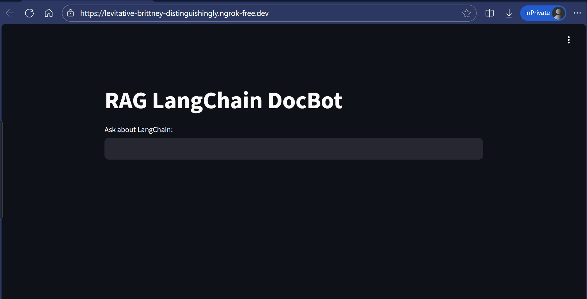
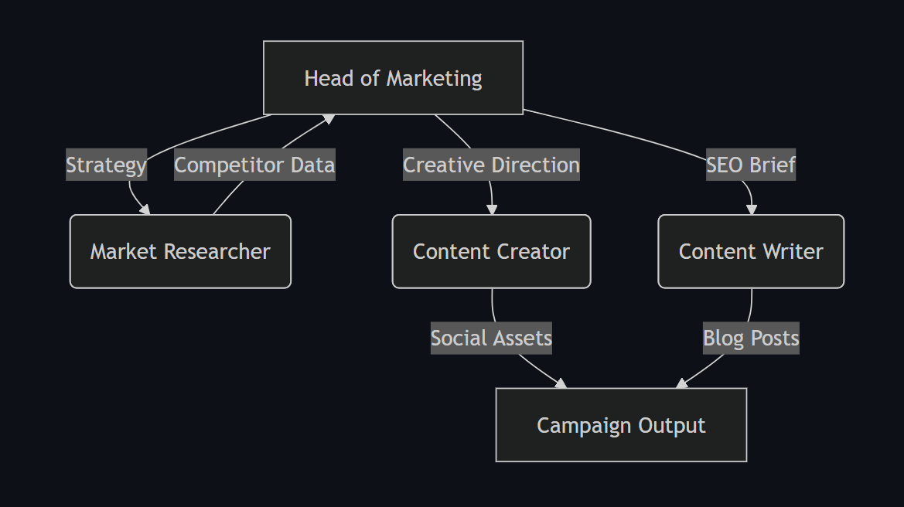

# Anas Sayed - AI & Machine Learning Portfolio

Hello! I'm Anas, a Computer Science student passionate about building practical, end-to-end AI solutions. This repository showcases my skills in **Generative AI**, **Autonomous Agents**, and **Deep Learning**.

---

## 🚀 Featured Projects

### 1. [DevDocs AI: RAG Q&A for Developer Docs](./DevDocs-AI-RAG-Chatbot/)

A RAG-powered chatbot built from the ground up, featuring a **custom vector search engine** implemented with Python and NumPy. It ingests technical documentation and provides instant, accurate answers to complex queries.

- **Key Skills:** LangChain, Hugging Face Transformers, FAISS (Vector Store), Streamlit, Embeddings, Prompt Engineering.
- **Result:** Achieved a ROUGE-L score of ~0.10, demonstrating a functional prototype for building specialized, fact-based Q&A applications.

### 2. [SubSlash AI: Autonomous Marketing Agent Swarm](./SubSlash-AI-Marketing-Agents/)

A hierarchical **multi-agent system** built with **CrewAI** that simulates a full-service marketing agency. Four specialized AI agents (Strategy, Research, Content, SEO) collaborate asynchronously to plan and execute a Go-To-Market strategy for a FinTech product without human intervention.

- **Key Skills:** Agentic Workflows, CrewAI, Multi-Agent Orchestration, Google Gemini API, Task Delegation.
- **Result:** Automated the generation of a comprehensive market research report, content calendar, and viral social scripts in under 3 minutes.

---

## 📂 Additional Machine Learning Projects

| Project Name | Description | Key Skills | Link |
| :--- | :--- | :--- | :--- |
| **Customer Churn Prediction** | An end-to-end classification model achieving 81% accuracy. | `Scikit-learn`, `Pandas`, `EDA` | [View Code](./ClassificationProject(CustomerChurnPred)/) |
| **Used Car Price Regression** | A regression model to predict used car prices after comprehensive EDA (R²=0.69). | `Seaborn`, `Random Forest`, `Feature Engineering` | [View Code](./RegressionProject(CarPricePred)/) |
| **AI Ethics Chatbot** | My foundational RAG project, built to answer questions from a custom knowledge base. | `Hugging Face`, `FAISS`, `NLP` | [View Code](./RAG-Ethics-Chatbot/) |
| **FullStack Goals App** | AI-assisted prototype of a mobile productivity app. | `React Native`, `Expo`, `Prompt Engineering` | [View Code](https://github.com/AnasSayed27/GoalsApp) |

---
*Connect with me: [LinkedIn](https://www.linkedin.com/in/anassayed27/) | [Email](anas.sayed004@gmail.com) | [Portfolio](https://anassayed27.github.io/)*
